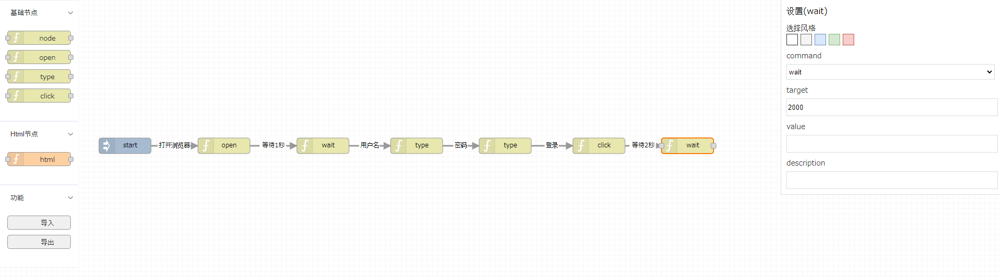
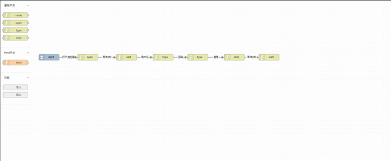

# Auto-Test Documentation

## Installation

### Folder Structure
```
auto-test
│  auto-server.bat
│  libs\auto-test.jar
│  driver
│  conf
```

### Prerequisites
1. **Java 17 or newer** is required.
2. Set the `AUTO_TEST_HOME` environment variable (default is the `auto-test` folder).
3. Download the appropriate WebDriver and place it in the `driver` directory:
   - [Chrome WebDriver](https://chromedriver.chromium.org/downloads) for Chrome 115 or newer ([Chrome for Testing](https://googlechromelabs.github.io/chrome-for-testing/)).
   - [Edge WebDriver](https://developer.microsoft.com/en-us/microsoft-edge/tools/webdriver/).

For manual downloads, refer to:
```
https://googlechromelabs.github.io/chrome-for-testing/known-good-versions-with-downloads.json
```

---

## Running Auto-Test

### Starting the Server
1. Run `auto-server.bat` to start the server.
2. Use the local server URL: [http://localhost:9191](http://localhost:9191).
3. Test cases (e.g., `case_template.xlsm`) can be found in the [testcases_example](doc/testcases_example) directory.

### Running Tests in cli
Use `auto-test.bat` to execute test cases:
```
Usage: auto-test [options]
  Options:
    -b, --baseDir
      Base directory of the program.
    -c, --cases
      Test cases to execute, separated by commas (e.g., 1-2,13).
    -f, --file
      Path to the test case file (absolute or relative to the work directory).
    -h, --help
      Display help message.
    -m, --mode
      Test mode (default: xlsx). Options: xlsx, csv, json.
    -d, --workDir
      Directory to store test case and result files.
```

---

## Features

### Design Test Cases in Web UI (at-designer)

The **at-designer** is a modern React-based visual test case designer that allows you to create and manage test flows through an intuitive drag-and-drop tree interface.

#### Key Features:
- **Visual Flow Design**: Create test cases using a tree-based structure with drag-and-drop support
- **Command Library**: Access common test commands (click, type, open, wait, etc.)
- **Control Flow**: Support for conditional statements (if/elseIf/else), loops (times), and sections
- **Real-time Editing**: Add, edit, delete, copy, and paste commands with keyboard shortcuts
- **Import/Export**: Save and load test cases in JSON format
- **Direct Execution**: Execute test flows directly from the designer
- **Keyboard Shortcuts**: 
  - `Alt+N`: Add new command
  - `Alt+E`: Edit selected command
  - `Alt+D`: Delete selected command
  - `Ctrl+C`: Copy command
  - `Ctrl+V`: Paste command
  - `Delete`: Delete selected command
  - `Arrow keys`: Navigate through commands
  - `Escape`: Clear selection

#### Getting Started with at-designer:
1. Start the server using `auto-server.bat`
2. Navigate to [http://localhost:9191](http://localhost:9191) to access the at-designer UI
3. Use the "新增根节点" (Add Root Node) button to start creating your test flow
4. Add commands by clicking the "+" icon on droppable nodes
5. Edit commands by double-clicking or using the edit button
6. Export your test flow using the "导出节点data" (Export Node Data) button
7. Execute your test flow directly using the "执行命令" (Execute Commands) button



### Execute Test Cases in Web UI


---

## Commands

Refer to the [Commands Documentation](doc/commands.md) for a list of supported commands.

---

## Additional Tools

- **Selenium IDE**: [Download Selenium IDE](https://github.com/SeleniumHQ/selenium-ide/releases)